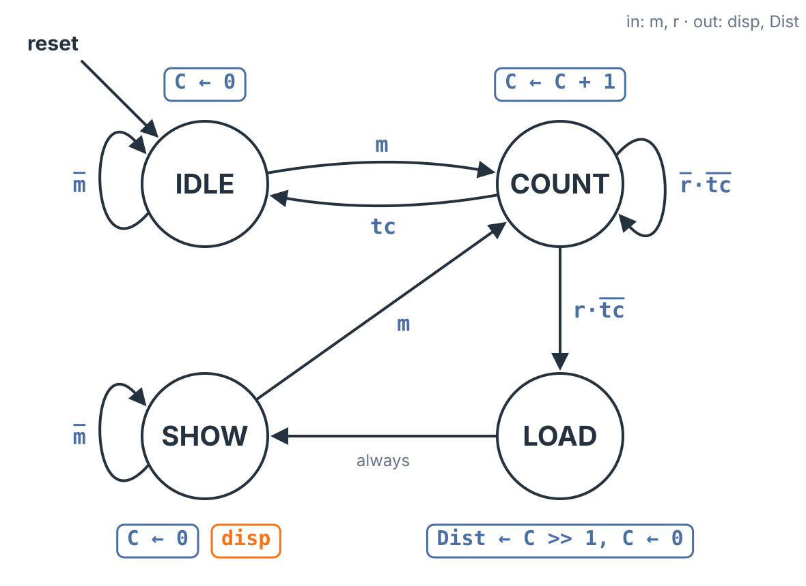
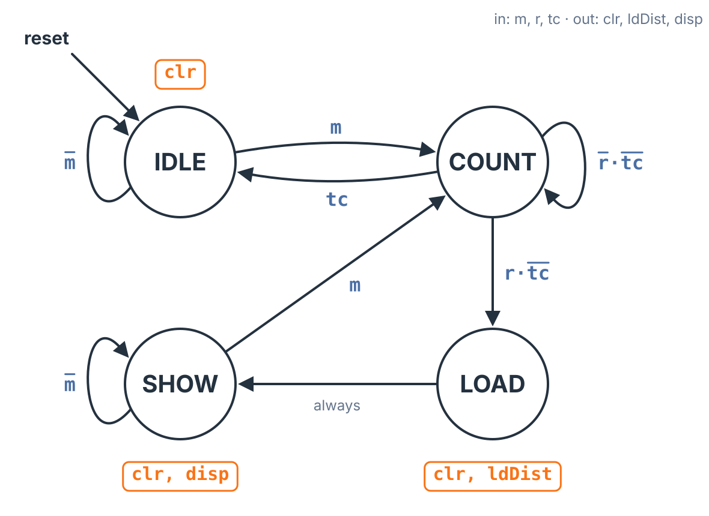

A laser range finder measures distance by timing light. Aim it at a golf flag, press the button, and the unit fires a short laser pulse; the pulse bounces off the flag and comes back to a receiver in the unit, and the time it took says how far away the flag is. The timing is a job for a finite state machine with a datapath (FSMD): a register counts clock cycles from the moment the laser fires until the echo arrives, and a controller decides when to start counting, when to stop, and when to show the result. This topic designs that subsystem from the problem statement through the FSMD, the datapath, the controller and a simulated timing trace, and it adds one case a real product cannot skip: the shot that misses and never comes back.

## The Larger System

The range finder is a subsystem: it is one block inside a larger design, and it talks to the blocks around it through a few signals.

- A **manual button M** is pressed by the golfer. Like any mechanical input it bounces and it is not synchronized to the clock, so it passes through a synchronizer and the **Switch Debouncer** first. What comes out is a clean one-clock pulse, $m$.
- On $m$, the **laser unit** fires a pulse of light.
- When the reflected light returns, the **receiver** subsystem asserts a one-clock pulse, $r$.
- Our subsystem takes $m$ and $r$ and drives the **display**: a register $\mathit{Dist}$ holding the distance, and a signal $\mathit{disp}$ that says there is a result to show. The display unit turns itself off after 5 seconds; that timing is the display's own job, not ours.

So the range finder's whole task is this: count the clocks between $m$ and $r$, turn the count into meters, store it in $\mathit{Dist}$, and assert $\mathit{disp}$.

## Why 300 MHz Makes the Arithmetic Easy

The speed of light is $3 \times 10^{8}$ m/s. Choose a clock of **300 MHz**, which is $3 \times 10^{8}$ cycles per second, and the clock period is

$$T = \frac{1}{300\ \text{MHz}} = 3.33\ \text{ns},$$

exactly the time light takes to travel **1 meter**. Each clock that passes while the pulse is in flight is one meter of light travel.

The light goes out to the flag *and back*, so a round trip of $n$ clocks means the flag is $n/2$ meters away. For a flag at 6 m, the pulse takes 6 clocks to get there and 6 to return: the count is $C = 12$, and the distance is $12 / 2 = 6$ m. (A 6 m golf shot is ridiculously short; the small number keeps the timing trace on one screen. A typical approach shot of 150 m is 300 clocks, one microsecond of light.)

Dividing by two needs no divider. In binary, halving a number is a shift right by one place, which drops the lowest bit:

$$\mathit{Dist} = C / 2 = C \gg 1$$

An odd count truncates: 13 clocks gives $13 \gg 1 = 6$ m, so the resolution is half a meter. A real unit would also subtract a fixed offset for the laser's own firing delay; this design assumes the laser fires on the clock edge that starts the count.

**How many bits?** Golf needs about 500 m of range, a 1,000 m round trip, so the count must reach 1,000. A **10-bit** register $C$ counts 0 to 1,023, which covers it. $\mathit{Dist}$ is one bit narrower, **9 bits** (0 to 511 m), because the shift drops a bit.

## The FSMD

The FSMD has four states, and every output depends on the state alone (a Moore design).



**IDLE** is the reset state. It holds $C \leftarrow 0$ and waits; $m$ moves it to COUNT.

**COUNT** adds one every clock, $C \leftarrow C + 1$, while it waits for the echo. When $r$ arrives it moves to LOAD.

**LOAD** does two transfers on one clock edge: it stores the distance, $\mathit{Dist} \leftarrow C \gg 1$, and clears the counter, $C \leftarrow 0$. It always moves on to SHOW.

**SHOW** asserts $\mathit{disp} = 1$ so the display shows $\mathit{Dist}$, and keeps $C \leftarrow 0$. It stays there until the golfer presses the button again: $m$ goes straight to COUNT for a new measurement. SHOW often lasts many seconds, billions of clocks, and the display blanks itself after 5 seconds while the range finder simply waits.

### The shot that never comes back

If the golfer misses the flag, the light never reflects into the receiver, $r$ never arrives, and COUNT would count forever (or, worse, wrap around to 0 and keep going). The design needs a way out. A **timeout** does it: let the status signal

$$\mathit{tc} = (C = 1023),$$

the counter all ones, mean "no echo within range," and add an arc from COUNT back to IDLE on $\mathit{tc}$. IDLE clears $C$, and the unit is ready for another try.

Adding that arc changes COUNT's other arcs. The conditions on the arcs leaving a state must never overlap: in any one clock, exactly one arc can be taken. If $r$ and $\mathit{tc}$ were both 1 in the same clock, the old labels would send COUNT to LOAD and to IDLE at once. So the timeout gets priority, and COUNT's three arcs become:

| From COUNT | Condition | Meaning |
|:--|:-:|:--|
| stay in COUNT | $\overline{r} \cdot \overline{\mathit{tc}}$ | no echo yet, still in range |
| to LOAD | $r \cdot \overline{\mathit{tc}}$ | echo, in range |
| to IDLE | $\mathit{tc}$ | out of range: give up |

The three conditions cover every combination of $r$ and $\mathit{tc}$ exactly once. The tie goes to the timeout for a reason: on the clock where $C = 1023$, the next $C + 1$ would wrap to 0, and LOAD would store a distance of 0 m.

## Reading the Datapath off the FSMD

Every operation in the FSMD becomes a piece of hardware.

**Register $C$, 10 bits.** Some transfer writes $C$ in every state: $C \leftarrow 0$ in IDLE, LOAD and SHOW, $C \leftarrow C + 1$ in COUNT. A register that loads every clock needs **no load enable**.

**An adder** for $C + 1$.

**A mux in front of $C$**, because $C$ loads one of two values: $C + 1$ while counting, or 0. Its select is the controller output $\mathit{clr}$: $\mathit{clr} = 1$ picks the constant 0, $\mathit{clr} = 0$ picks $C + 1$.

**Register $\mathit{Dist}$, 9 bits, with a load enable $\mathit{ldDist}$.** $\mathit{Dist}$ is written only in LOAD and must hold its value the rest of the time, so the display can show it, so it needs an enable.

**The shift is wires.** $\mathit{Dist}$'s input is $C \gg 1$: bits $C_9$ through $C_1$ connect straight to $\mathit{Dist}$'s nine inputs, each one place over, and $C_0$ is simply not connected. No shift register and no gates: the divide-by-two is in the wiring.

**A comparator** for $C = 1023$, which produces the status signal $\mathit{tc}$ for the controller. Since 1023 is all ones, the comparator is just a 10-input AND gate.

Two control signals, $\mathit{clr}$ and $\mathit{ldDist}$, go from the controller to the datapath, and one status signal, $\mathit{tc}$, comes back.

## The Controller

With the datapath doing the arithmetic, the controller is an ordinary finite state machine. Take the FSMD, keep the states and arcs, and replace each state's transfers with the control signals that make them happen. The inputs are $m$ and $r$ from outside and $\mathit{tc}$ from the datapath; the outputs are $\mathit{clr}$ and $\mathit{ldDist}$ to the datapath and $\mathit{disp}$ to the display:



$\mathit{clr}$ is 1 in every state that does $C \leftarrow 0$, $\mathit{ldDist}$ is 1 in LOAD, and $\mathit{disp}$ is 1 in SHOW:

$$\mathit{clr} = Q_{\mathrm{IDLE}} + Q_{\mathrm{LOAD}} + Q_{\mathrm{SHOW}} \qquad \mathit{ldDist} = Q_{\mathrm{LOAD}} \qquad \mathit{disp} = Q_{\mathrm{SHOW}}$$

With a one-hot assignment, one flip-flop per state, each next-state equation has one term per arc into the state:

$$Q_{\mathrm{IDLE}}^{+} = Q_{\mathrm{IDLE}} \cdot \overline{m} + Q_{\mathrm{COUNT}} \cdot \mathit{tc}$$

$$Q_{\mathrm{COUNT}}^{+} = Q_{\mathrm{IDLE}} \cdot m + Q_{\mathrm{SHOW}} \cdot m + Q_{\mathrm{COUNT}} \cdot \overline{r} \cdot \overline{\mathit{tc}}$$

$$Q_{\mathrm{LOAD}}^{+} = Q_{\mathrm{COUNT}} \cdot r \cdot \overline{\mathit{tc}} \qquad Q_{\mathrm{SHOW}}^{+} = Q_{\mathrm{LOAD}} + Q_{\mathrm{SHOW}} \cdot \overline{m}$$

The $\overline{\mathit{tc}}$ in $Q_{\mathrm{LOAD}}^{+}$ is the tie rule in hardware: an echo on the timeout clock does not reach LOAD.

## Watching It Run

The table is a simulation of the complete controller and datapath. To keep it short, the counter here is 4 bits wide, so $\mathit{tc}$ fires at $C = 15$; the design is otherwise the same. The golfer fires at a flag 6 m away. Each row is one clock cycle.

| Cycle | $m$ | $r$ | State | $C$ | $\mathit{tc}$ | $\mathit{ldDist}$ | $\mathit{Dist}$ | $\mathit{disp}$ |
|:-:|:-:|:-:|:-:|:-:|:-:|:-:|:-:|:-:|
| 0 | 0 | 0 | IDLE | 0 | 0 | 0 | 0 | 0 |
| 1 | 1 | 0 | IDLE | 0 | 0 | 0 | 0 | 0 |
| 2 | 0 | 0 | COUNT | 0 | 0 | 0 | 0 | 0 |
| 3 | 0 | 0 | COUNT | 1 | 0 | 0 | 0 | 0 |
| ⋮ | | | | | | | | |
| 12 | 0 | 0 | COUNT | 10 | 0 | 0 | 0 | 0 |
| 13 | 0 | 1 | COUNT | 11 | 0 | 0 | 0 | 0 |
| 14 | 0 | 0 | LOAD | 12 | 0 | 1 | 0 | 0 |
| 15 | 0 | 0 | SHOW | 0 | 0 | 0 | 6 | 1 |

The button pulse $m$ arrives in cycle 1, and the next edge moves the controller to COUNT, where $C$ counts up from 0. The echo $r$ arrives in cycle 13 with $C = 11$. On the next edge the controller moves to LOAD, and the counter takes one more step to $C = 12$: twelve clocks of light, out and back. In LOAD, $\mathit{ldDist} = 1$, so the next edge loads $\mathit{Dist} \leftarrow 12 \gg 1 = 6$ and clears $C$. From cycle 15 the controller sits in SHOW with $\mathit{disp} = 1$ and the display reads 6 m.

SHOW then lasts seconds, which at 300 MHz is billions of clocks, so the interactive's **Timing Trace** tab draws a break in the time axis there. After the break the golfer fires again: a 4 m shot counts to $C = 8$ and shows $\mathit{Dist} = 4$. A third shot misses. With no echo, $C$ climbs to 15, $\mathit{tc} = 1$, and the controller drops back to IDLE with $\mathit{disp} = 0$; $\mathit{Dist}$ keeps its old value but is not shown.

## In Practice: A Slower Clock

The 300 MHz clock was chosen to make the arithmetic clean, and a real handheld unit would not use it. Dynamic power grows with the clock frequency (see **Static and Dynamic Power**), and a battery-powered device runs a much slower clock, something like the 16 MHz of a typical consumer microcontroller.

At 16 MHz the period is $T = 62.5$ ns. Light travels 18.75 m in that time, and because the light goes out and back, one count is $18.75 / 2 = 9.375$ m of range. The 6 m flag's echo returns after 40 ns, inside the very first period, so a plain clock count reads 0.

Real range finders fix this with extra timing circuitry that measures *where within a clock period* the echo arrived, a **time-to-digital converter** (TDC). It splits the period into fine steps using controlled delays. With 32 fine steps per 62.5 ns period, each step is 1.953 ns, or 0.293 m of range. The 6 m echo is coarse count 0, fine count 20: $20 \times 1.953 = 39.06$ ns, which reads as 5.86 m, short by less than one step. The FSMD keeps the same shape (start on $m$, stop on $r$, then compute); the datapath adds the fine count. The interactive's **In Practice** tab walks through these numbers.

## The Range Finder in Verilog

The Verilog follows the hardware block for block: the datapath (register $C$ with its adder and mux, the comparator, and register $\mathit{Dist}$ fed by the shifted wires), the one-hot controller with one term per arc, and the Moore outputs. It is here for reference, to come back to when the course turns to describing state machines in Verilog.

```verilog
module lrf #(
  parameter W = 10   // bits in C
) (
  input  clk, rst,
  input  m, r,       // fire, echo (pulses)
  output disp,       // display on
  output reg [W-2:0] dist
);
  reg  q_idle, q_count, q_load, q_show;
  reg  [W-1:0] c;     // register C
  wire tc;            // status
  wire clr, ldDist;   // control

  // datapath: register C with its adder
  // and mux, a comparator C = all ones,
  // register Dist fed by C >> 1 (wires)
  assign tc = (c == {W{1'b1}});
  always @(posedge clk)
    if (rst)      c <= 0;
    else if (clr) c <= 0;         // mux: 0
    else          c <= c + 1'b1;  // adder
  always @(posedge clk)
    if (rst)         dist <= 0;
    else if (ldDist) dist <= c[W-1:1];
  // controller: one-hot, one term per arc
  always @(posedge clk)
    if (rst) begin
      q_idle  <= 1'b1;
      q_count <= 1'b0;
      q_load  <= 1'b0;
      q_show  <= 1'b0;
    end
    else begin
      q_idle  <= q_idle & ~m
               | q_count & tc;
      q_count <= q_idle & m
               | q_show & m
               | q_count & ~r & ~tc;
      q_load  <= q_count & r & ~tc;
      q_show  <= q_load
               | q_show & ~m;
    end

  // outputs: all Moore
  assign clr    = q_idle | q_load | q_show;
  assign ldDist = q_load;
  assign disp   = q_show;
endmodule
```

Simulated in Icarus Verilog at $W = 10$ and 300 MHz, against an independently written model that counts clocks directly, the module gives these distances:

| Round trip (clocks) | 12 | 13 | 2 | 1,000 | 1,023 | 1,024 | no echo |
|:--|:-:|:-:|:-:|:-:|:-:|:-:|:-:|
| Result | 6 m | 6 m | 1 m | 500 m | 511 m | timeout | timeout |

and reports

```
SHOTS mismatches=0 onehot_bad=0
```

The two versions agree on every clock and exactly one state flip-flop is 1 at all times. The 1,000-clock shot is the 500 m golf requirement; 1,023 clocks is the longest the 10-bit counter can measure, and 1,024 clocks, like a shot with no echo at all, times out. A separate test puts the echo on the same clock as $\mathit{tc}$, and the controller goes to IDLE, not LOAD: the tie rule holds.

## Key Takeaways

A laser range finder times light: at 300 MHz light travels 1 m per clock, so a round trip of $C$ clocks puts the target $C/2$ meters away, and $\mathit{Dist} = C \gg 1$ is just wiring. The range finder is a subsystem: it takes a debounced, synchronized pulse $m$ and a receiver pulse $r$, and gives a display a register $\mathit{Dist}$ and a signal $\mathit{disp}$. Its FSMD has four states: IDLE clears $C$ and waits for $m$, COUNT counts until $r$, LOAD stores $\mathit{Dist} \leftarrow C \gg 1$ and clears $C$, and SHOW asserts $\mathit{disp}$ until the next $m$. A timeout $\mathit{tc} = (C = 1023)$ handles the shot that never returns, and it wins a tie with $r$, so COUNT's arcs are $\overline{r} \cdot \overline{\mathit{tc}}$, $r \cdot \overline{\mathit{tc}}$ and $\mathit{tc}$, never overlapping. The datapath reads off the FSMD: a 10-bit register $C$ with no enable (it loads every clock), an adder, a mux on $\mathit{clr}$, a comparator for $\mathit{tc}$, and a 9-bit $\mathit{Dist}$ with load enable $\mathit{ldDist}$. The controller is an ordinary Moore FSM with $\mathit{clr} = Q_{\mathrm{IDLE}} + Q_{\mathrm{LOAD}} + Q_{\mathrm{SHOW}}$, $\mathit{ldDist} = Q_{\mathrm{LOAD}}$ and $\mathit{disp} = Q_{\mathrm{SHOW}}$. A real battery-powered unit runs a slower clock and adds a time-to-digital converter to measure fractions of a period.

## Review Questions

**1. The range finder runs on a 300 MHz clock, so light travels 1 m per clock period. The counter reads $C = 40$ when the echo arrives at LOAD. How far away is the target?**

A) 40 m\
B) 80 m\
C) 20 m\
D) 13.3 m

**2. Why does register $\mathit{Dist}$ need a load enable when register $C$ does not?**

A) $\mathit{Dist}$ is wider than $C$\
B) $\mathit{Dist}$ is written only in LOAD and must hold its value in every other state, while some transfer writes $C$ in every state\
C) $C$ is cleared by reset and $\mathit{Dist}$ is not\
D) A shifted value cannot be loaded without an enable

**3. How does the datapath compute $C \gg 1$ for $\mathit{Dist}$?**

A) With a shift register clocked once per measurement\
B) With an adder that subtracts half of $C$\
C) With wires: $C_9$ through $C_1$ connect to $\mathit{Dist}$'s inputs one place over, and $C_0$ is left unconnected\
D) With a divider circuit after the comparator

**4. In COUNT, the echo $r$ and the timeout $\mathit{tc}$ can both be 1 in the same clock. Which arc does the controller take, and why?**

A) To IDLE, because the arc conditions are $r \cdot \overline{\mathit{tc}}$ and $\mathit{tc}$, so the timeout wins; otherwise $C$ would wrap to 0 and LOAD would store 0 m\
B) To LOAD, because a real echo should always be displayed\
C) Both arcs at once, which is why the design is one-hot\
D) It stays in COUNT until one of them goes away

**5. Which one-hot equation describes all the ways to enter SHOW?**

A) $Q_{\mathrm{SHOW}}^{+} = Q_{\mathrm{LOAD}} \cdot r$\
B) $Q_{\mathrm{SHOW}}^{+} = Q_{\mathrm{LOAD}} + Q_{\mathrm{SHOW}} \cdot \overline{m}$\
C) $Q_{\mathrm{SHOW}}^{+} = Q_{\mathrm{SHOW}} \cdot m$\
D) $Q_{\mathrm{SHOW}}^{+} = Q_{\mathrm{COUNT}} \cdot r + Q_{\mathrm{SHOW}}$

**6. A real handheld range finder runs at 16 MHz instead of 300 MHz. What is the main reason, and what does it cost?**

A) To lower dynamic power, which grows with clock frequency; one count is now 9.375 m of range, so extra circuitry must measure fractions of a clock period\
B) To raise the noise margin; nothing else changes\
C) Because light is slower at low frequency; the counter needs more bits\
D) To make $\mathit{Dist} = C \gg 1$ exact; the timeout is no longer needed

## Answer Explanations

**1. C.** $C$ counts the clocks of the whole round trip, out to the target and back, and each clock is 1 m of light travel, so the light went 40 m in total and the target is $40 / 2 = 20$ m away: $\mathit{Dist} = C \gg 1 = 20$. Forty meters (A) forgets the round trip, 80 m (B) doubles instead of halving, and 13.3 m (D) mixes in the 3.33 ns period.

**2. B.** A load enable lets a register hold its value, which is needed only when some state leaves it alone. $C$ is written in every state ($C \leftarrow 0$ or $C \leftarrow C + 1$), so it loads every clock and the mux alone picks what. $\mathit{Dist}$ is written only in LOAD and has to keep the distance through SHOW and beyond, so it needs $\mathit{ldDist}$. Width (A), reset (C) and the shift (D) have nothing to do with it.

**3. C.** Shifting right by one place moves every bit down one position and drops the lowest, so wiring $C_9 \ldots C_1$ to $\mathit{Dist}_8 \ldots \mathit{Dist}_0$ is the whole operation. No clocked shift register (A), adder (B) or divider (D) is needed.

**4. A.** The arcs out of a state must never overlap, so the conditions are written $r \cdot \overline{\mathit{tc}}$ to LOAD and $\mathit{tc}$ to IDLE; with both inputs at 1 only the IDLE arc's condition is true. The timeout gets priority because at $C = 1023$ the next count wraps to 0, and LOAD would store a distance of 0 m. A controller takes exactly one arc per clock (C), and the stay arc is $\overline{r} \cdot \overline{\mathit{tc}}$, which is false here (D).

**5. B.** One-hot gives one term per arc into the state. SHOW is entered from LOAD unconditionally (the "always" arc, term $Q_{\mathrm{LOAD}}$) and from itself while there is no new button press (term $Q_{\mathrm{SHOW}} \cdot \overline{m}$). Choice A puts a condition on the unconditional arc, C is the condition for *leaving* SHOW, and D uses an arc that goes to LOAD, not SHOW.

**6. A.** Dynamic power is proportional to the clock frequency, so a slower clock saves battery. The cost is resolution: at 16 MHz a period is 62.5 ns, 18.75 m of light, or 9.375 m of range per count, so a time-to-digital converter splits the period into fine steps. Noise margin (B) depends on the supply voltage, not the clock; light's speed does not depend on the clock (C); and the timeout is still needed (D).
