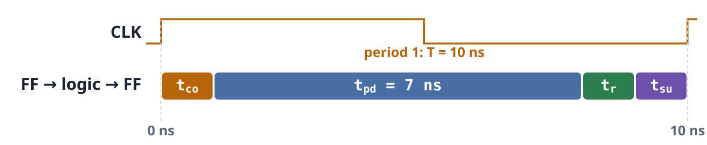
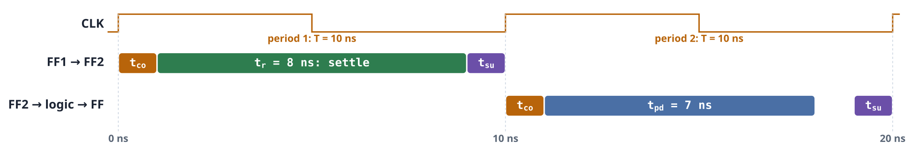

An input from the outside world knows nothing about the system clock, so now and then it changes so close to a clock edge that it catches the flip-flop sampling it. **Metastable States** described what happens next: the output hovers before it settles. **Synchronizers** showed the standard remedy: give the caught flip-flop time to settle before anything reads it, which makes the risk negligible, not zero. This topic puts a number on "negligible." Failures caused by metastable states happen at random, so the useful measure is the average time between them, the **mean time between failures** (MTBF). A simple model of MTBF shows exactly which design choices make a system reliable and which quietly ruin it.

## Catching an Edge

A flip-flop has a decision window around each clock edge. If its input is steady through the whole window, it reads the input cleanly. Most changes land far from an edge and cause no trouble at all. Even most changes that land inside the decision window are decided at once: the flip-flop simply keeps the old value or takes the new one.

Only a change that lands in a very thin band right at the edge catches the flip-flop. Its output leaves the old level, hovers near the halfway point, and then settles to 0 or 1. This band is called $T_0$, the **catch slice**. It is a property of the flip-flop, characterized by its manufacturer by measuring real hardware. In this topic's example, $T_0 = 0.1$ ns against a 10 ns clock period, so about **1 change in 100** is caught.

The interactive above runs this as a simulation: step one input change at a time, or a hundred or a thousand at once, and watch where each change lands. The caught ones leave a faint trace on the output, and the traces fan out, because each catch settles at a different time.

## Resolution Time

How long does a caught flip-flop hover? It varies from catch to catch: mostly briefly, occasionally much longer. In a simulation of 1,000 catches, 410 settle within the first 0.1 ns, the count keeps falling the longer you wait, and only a handful are still hovering after 1 ns.

The fraction still undecided after a time $t$ falls off exponentially:

$$\text{still hovering after } t = e^{-t/\tau}$$

Here $\tau$ is the flip-flop's **settling time constant**. It is another manufacturer-characterized property, and a faster flip-flop has a smaller $\tau$. With $\tau = 0.2$ ns, every extra nanosecond of waiting divides the chance by $e^{5} \approx 148$. After 1 ns, 1 catch in 148 is still undecided; the 1,000-catch simulation found 6.

The time a design actually gives the flip-flop to settle before something reads its output is the **resolution time** $t_r$. A caught flip-flop only causes a failure if it is still hovering at that moment.

## Why a Number? Mean Time Between Failures

A catch cannot be prevented: an input that ignores the clock will eventually change at the wrong instant. And "rare" depends on scale. With fast clocks and busy inputs, a one-in-a-hundred catch happens thousands of times a second. Designers need a number that says how often a design will actually fail, so they can show it is reliable enough.

That number is the mean time between failures, a standard measure in reliability engineering. Synchronizer failures from metastability were demonstrated and widely discussed in the early 1970s, after they had caused hard-to-trace failures in real computers. Today flip-flops are characterized by parameters like $\tau$ and $T_0$, and FPGA design tools report the MTBF of every synchronizer chain. The model is simple, and even as an approximation it shows clearly what to change.

## The Formula, One Term at a Time

$$\text{MTBF} = \frac{e^{\,t_r/\tau}}{T_0 \cdot f_{\mathrm{clk}} \cdot f_{\mathrm{data}}}$$

We want MTBF as large as possible. The bottom of the fraction counts how often the flip-flop is caught; the top says how unlikely a caught flip-flop is to still be hovering when it is read. Term by term, with this topic's example values:

| Term | Meaning | Example value |
|:--|:--|:-:|
| $f_{\mathrm{data}}$ | how often the input changes | 1 MHz: a million times a second |
| $f_{\mathrm{clk}}$ | how often the clock samples | 100 MHz: an edge every 10 ns |
| $T_0$ | the catch slice at each edge | 0.1 ns |
| $T_0 \cdot f_{\mathrm{clk}} \cdot f_{\mathrm{data}}$ | how often it is caught | 10,000 a second |
| $t_r$, $\tau$ | time to settle; the time constant | $t_r = 8$ ns; $\tau = 0.2$ ns |
| $e^{t_r/\tau}$ | 1 catch in this many is still hovering | $e^{40} \approx 2.35 \times 10^{17}$ |
| MTBF | the top divided by the bottom | about 746,000 years |

The input and the clock both sit in the denominator: a busier input and a faster clock each give more chances to be caught. $T_0$ sits there too, so a flip-flop with a narrower catch slice is more reliable. The settling time and $\tau$ sit in the exponent, where they matter far more.

## Settling Time Is the Slack

Where does $t_r$ come from? It is the **slack** of the path leaving the caught flip-flop: what is left of the clock period after the flip-flop's clock-to-output delay, any logic, and the next flip-flop's setup time.

$$t_r = T - t_{\mathrm{co}} - t_{\mathrm{pd}} - t_{\mathrm{su}}$$

A catch is simply a flip-flop whose output arrives late by its hover time, and the next flip-flop still reads it correctly as long as that extra delay fits in the slack. So **a metastable catch causes a failure only if it hovers longer than the slack.**

With $t_{\mathrm{co}} = t_{\mathrm{su}} = 1$ ns and 7 ns of logic after the caught flip-flop, very little is left of a 10 ns period:

That leaves $t_r = 1$ ns, and an MTBF of 14.8 ms: a failure about seventy times a second. A two-flip-flop synchronizer puts no logic after the first flip-flop, so it gets almost the whole period to settle, $t_r = 10 - 2 = 8$ ns, and the logic waits one extra clock:

Now the MTBF is about **746,000 years**. Seven more nanoseconds of slack is 35 more time constants, which multiplies the MTBF by $e^{35} \approx 1.6 \times 10^{15}$. Settling time sits in the exponent, so it dominates every other term, and a synchronizer's whole job is to buy it.

Adding a third flip-flop stacks a second period of slack, $8 + 8 = 16$ ns (a simplification: each stage's slack adds in the exponent, which real chains follow only approximately). Each stage costs one more clock of delay before the rest of the circuit sees the input.

## Longer or Shorter?

Once the formula is clear, the effect of a design change can be predicted before any number is computed. Each case below starts from the 100 MHz synchronizer, MTBF about 746,000 years:

| Change | What moves | MTBF |
|:--|:--|:-:|
| Add a third flip-flop | $t_r$: 8 → 16 ns | longer: about $1.8 \times 10^{23}$ years |
| Clock 100 → 200 MHz | $t_r$: 8 → 3 ns, and twice the catches | shorter: about 2.7 minutes |
| The input changes twice as often | $f_{\mathrm{data}}$: 1 → 2 MHz | shorter: about 373,000 years |
| 3 ns of logic between the two flip-flops | $t_r$: 8 → 5 ns | shorter: about 83 days |
| Faster flip-flops | $\tau$: 0.2 → 0.15 ns | longer: about $4.6 \times 10^{11}$ years |
| Clock 100 → 50 MHz | $t_r$: 8 → 18 ns, and half the catches | longer: about $7.7 \times 10^{27}$ years |

Anything in the exponent ($t_r$ or $\tau$) moves the MTBF by orders of magnitude; anything in the denominator moves it only by a factor. A change of clock speed does both at once, which is why doubling the clock turns 746,000 years into minutes. Logic squeezed between the synchronizer's flip-flops is the quiet mistake: it looks harmless, but it spends the slack the synchronizer was built to provide.

## Making Millions of Them

The MTBF so far is for one board. A product ships in many copies, and every copy is failing independently, so a fleet of $N$ boards fails somewhere $N$ times as often.

| | 100 MHz, $t_r = 8$ ns | 200 MHz, $t_r = 3$ ns |
|:--|:-:|:-:|
| one board | about 746,000 years | 2.72 minutes |
| $10^6$ boards | about 272 days | about 163 µs |

At 100 MHz, a million boards see one failure somewhere every 272 days. Whether that is acceptable is a business decision; for a consumer product it may well be. At 200 MHz the same design fails somewhere in the fleet thousands of times a second. The remedy is always the same: more settling time, from another flip-flop or a slower clock on the synchronizer, until the whole field is safe.

## Key Takeaways

An input that ignores the clock occasionally lands in the thin catch slice $T_0$ at a clock edge and leaves the flip-flop hovering; each catch then settles after a random time, and the fraction still undecided after a time $t$ is $e^{-t/\tau}$. Both $T_0$ and $\tau$ are characterized by the flip-flop's manufacturer, and a faster flip-flop has a smaller $\tau$. The mean time between failures is

$$\text{MTBF} = \frac{e^{\,t_r/\tau}}{T_0 \cdot f_{\mathrm{clk}} \cdot f_{\mathrm{data}}},$$

where the denominator counts catches per second and the resolution time $t_r$ is the slack of the path out of the caught flip-flop: a catch fails only if it hovers longer than the slack. Because $t_r$ is in the exponent it dominates: with 1 ns of slack the example fails every 14.8 ms, and a two-flip-flop synchronizer's 8 ns raises that to about 746,000 years. Faster clocks shrink the slack and add catches, logic between the synchronizer's flip-flops spends its slack, and a product shipped in millions of copies fails millions of times as often, so reliability has to be designed for the whole fleet.

## Review Questions

**1. A flip-flop's clock runs at 100 MHz, its input changes a million times a second, and its catch slice is $T_0 = 0.1$ ns. How often is it caught?**

A) 100 times a second\
B) A million times a second\
C) 10,000 times a second\
D) 10 times a second

**2. Why does adding a two-flip-flop synchronizer raise the MTBF so dramatically, from 14.8 ms to about 746,000 years?**

A) It reduces how often the input changes\
B) It gives the caught flip-flop nearly a whole clock period of slack, and the slack sits in the exponent\
C) It narrows the catch slice $T_0$\
D) It doubles the clock frequency seen by the input

**3. A designer adds 3 ns of logic between the two flip-flops of a synchronizer. What happens to the MTBF?**

A) Longer, because the logic filters glitches\
B) Unchanged, because the logic is after the first flip-flop\
C) Shorter, but only by a factor of about 2\
D) Shorter, by orders of magnitude, because the slack drops from 8 ns to 5 ns

**4. Which statement about $\tau$ is correct?**

A) It is the flip-flop's settling time constant, characterized by the manufacturer; a faster flip-flop has a smaller $\tau$ and a longer MTBF\
B) It is the clock period, chosen by the designer\
C) It is the width of the catch slice at each edge\
D) A larger $\tau$ gives a longer MTBF

**5. One board has an MTBF of about 746,000 years. The product ships a million boards. How often does a failure happen somewhere in the field?**

A) Every 746,000 years, since each board is independent\
B) About every 272 days\
C) About every 746 years\
D) About every 7.46 seconds

## Answer Explanations

**1. C.** Catches per second are $T_0 \cdot f_{\mathrm{clk}} \cdot f_{\mathrm{data}} = 0.1 \times 10^{-9} \times 10^{8} \times 10^{6} = 10^{4}$. Equivalently, $T_0 / T = 0.1/10 = 1/100$ of the changes land in the slice, and there are a million changes a second. A million (B) counts every change, 100 (A) and 10 (D) drop powers of ten.

**2. B.** The first flip-flop drives nothing but the second, so its slack grows from 1 ns to $10 - 2 = 8$ ns. Seven more nanoseconds is 35 more time constants, a factor of $e^{35} \approx 1.6 \times 10^{15}$. The synchronizer does not change how often the input changes (A), the catch slice (C) or the clock (D).

**3. D.** The logic spends the synchronizer's slack: $t_r$ falls from 8 ns to 5 ns, 15 time constants, and MTBF falls by $e^{15} \approx 3.3 \times 10^{6}$, from about 746,000 years to about 83 days. A factor of 2 (C) would come from a denominator term; the logic is not a filter (A); and it sits exactly where the slack is spent (B).

**4. A.** $\tau$ sets how fast a caught flip-flop's chance of still hovering decays, $e^{-t/\tau}$. It is a device constant: a faster flip-flop has a smaller $\tau$, so $t_r/\tau$ is larger and the MTBF longer. The clock period (B) and the catch slice $T_0$ (C) are different terms, and a larger $\tau$ shortens the MTBF (D).

**5. B.** A million independent boards fail a million times as often: $746{,}000 \text{ years} \div 10^{6} \approx 0.746$ years, about 272 days. Independence is exactly why the rate multiplies (A); 746 years (C) divides by only a thousand, and 7.46 seconds (D) mixes up the units.
