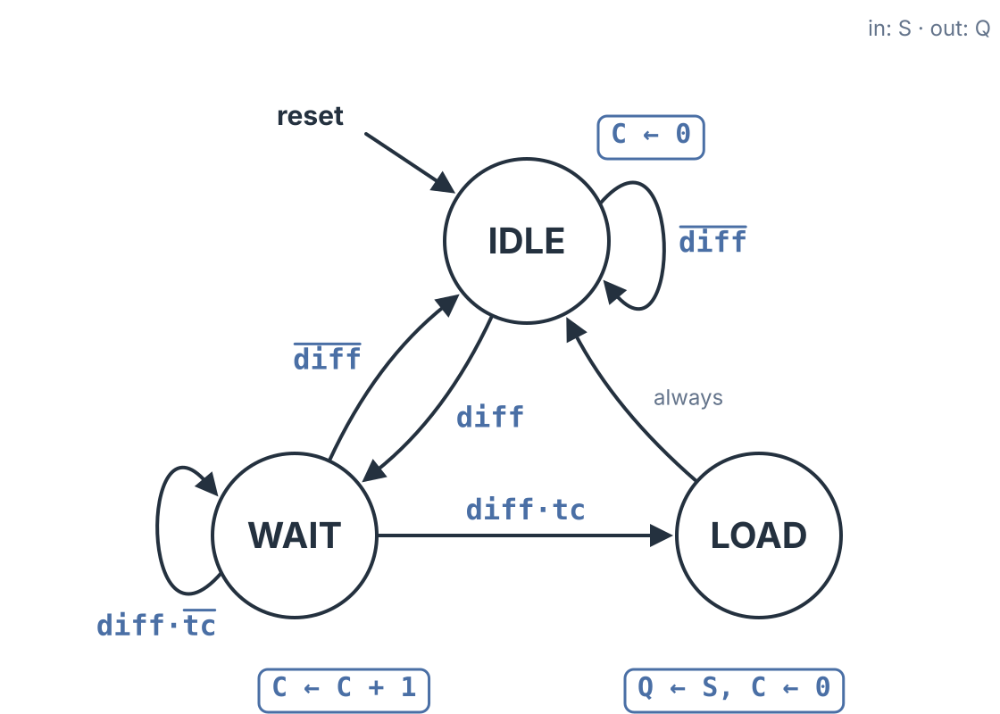

Every digital system that reads a pushbutton or a toggle switch has to deal with a mechanical fact: switch contacts bounce. When the button is pressed, the metal contacts strike, spring apart, and strike again several times before they settle. A person never notices, but a clocked circuit sees every one of those bounces as a separate press. A **switch debouncer** is the circuit that waits the bouncing out and passes along one clean change for each real press. It is also a complete worked example of a finite state machine with a datapath (FSMD): a short description in words becomes an FSMD, the FSMD becomes a datapath and a controller, and the controller becomes one-hot equations and Verilog.

## Why Bouncing Matters to a Clocked Circuit

How long contacts bounce depends on the switch. A few milliseconds is common, some switches bounce longer, and designers usually wait out a safe window of 10 to 20 ms. For a person, a few milliseconds is nothing. For a digital system it is a very long time. A 100 MHz clock ticks 100,000 times every millisecond, so a single bounce lasting even a fraction of a millisecond is thousands of clock cycles wide. To the circuit it does not look like a glitch at all. It looks like a perfectly good logic level that happens to change several times.

Filtering out short pulses therefore does not work. The only reliable test is time: **accept a new level only after it has held steady for $N$ clocks in a row.** In a real design $N$ is large, in the thousands to millions. To keep the diagrams and timing tables readable, this topic uses $N = 4$; the last section sizes $N$ for a real clock.

## Synchronize First

The button comes from the outside world, which knows nothing about the system clock. As **Synchronizers** established, any asynchronous input goes through a synchronizer first: two flip-flops in series, which keep a metastable state from reaching the rest of the design. The synchronized button is called $S$.

The synchronizer solves metastability, not bouncing. Because it only delays the button by two clocks and lines its changes up with clock edges, $S$ bounces just as much as the raw button does. The debouncer still has to decide when $S$ has settled.

The clean output is a register called $Q$. The whole circuit uses a handful of names:

| Name | Kind | Meaning |
|:--|:--|:--|
| $\mathit{btn}$ | input | the raw button, asynchronous and bouncing |
| $S$ | data | $\mathit{btn}$ after the two-flip-flop synchronizer |
| $Q$ | register | the clean, debounced output |
| $C$ | register | the count of clocks that $S$ and $Q$ have disagreed |
| $\mathit{diff}$ | status | 1 when $S \ne Q$ |
| $\mathit{tc}$ | status | 1 when $C = N - 1$ |
| $\mathit{clr}$ | control | 1 clears $C$; 0 lets $C$ count |
| $\mathit{ldQ}$ | control | 1 loads $S$ into $Q$ |

## The Idea in Words

The debouncer compares $S$ with $Q$ on every clock. Most of the time they agree: the button is not changing and there is nothing to do. When they disagree, something is happening, but it might be the start of a real press or just one bounce. So the circuit starts counting clocks.

If $S$ and $Q$ agree again before the count reaches $N$, the disagreement was a bounce. The count is thrown away and the circuit goes back to watching. If they keep disagreeing for $N$ clocks in a row, the new level is real, so the circuit copies $S$ into $Q$, clears the count, and goes back to watching. The same logic handles a release: when the button lets go, $S$ falls, disagrees with $Q = 1$, and has to hold 0 for $N$ clocks before $Q$ follows it down.

## The FSMD

Those sentences turn directly into a three-state FSMD. Each state is named for what the debouncer believes about the button:

- **IDLE**, "$S$ agrees with $Q$": $C \leftarrow 0$. Stay on $\overline{\mathit{diff}}$; go to WAIT on $\mathit{diff}$.
- **WAIT**, "$S$ disagrees, count it": $C \leftarrow C + 1$. Return to IDLE on $\overline{\mathit{diff}}$ (a bounce); go to LOAD on $\mathit{diff} \cdot \mathit{tc}$; stay on $\mathit{diff} \cdot \overline{\mathit{tc}}$.
- **LOAD**, "believe it": $Q \leftarrow S$, $C \leftarrow 0$. Always return to IDLE.



$C$ starts at 0 because IDLE clears it, and WAIT adds one each clock. When $C$ reaches $N - 1$, the comparator raises $\mathit{tc}$, and if $S$ still disagrees with $Q$ that clock, the machine has spent exactly $N$ clocks in WAIT and moves on to LOAD.

The arc out of WAIT into LOAD is $\mathit{diff} \cdot \mathit{tc}$, not $\mathit{tc}$ alone. With $\mathit{tc}$ alone, a clock with $\mathit{tc} = 1$ and $\mathit{diff} = 0$ would make two exits true at once, back to IDLE and on to LOAD. Including $\mathit{diff}$ makes the three arcs out of WAIT mutually exclusive and keeps the rule honest: a level is accepted only if it is still there on the last clock of the count.

## From the FSMD to a Datapath

The datapath is built from the register transfers, one piece at a time, using nothing but registers, an adder, a mux and comparators.

**Registers.** The FSMD writes two registers, $C$ and $Q$, so both go in the datapath.

**$C \leftarrow C + 1$ needs an adder.** One adder input is $C$ and the other is the constant 1, and its output $C + 1$ feeds back toward $C$.

**$C \leftarrow 0$ needs a mux.** $C$ receives two different values, 0 in IDLE and LOAD and $C + 1$ in WAIT, so a 2-to-1 mux chooses between them. Its select line is the control signal $\mathit{clr}$. The constant 0 goes on input 1 and the adder's $C + 1$ goes on input 0, so $\mathit{clr} = 1$ clears the count and $\mathit{clr} = 0$ lets it count. Register $C$ loads on every clock; the mux decides what it loads.

**$Q \leftarrow S$ needs a load enable.** $Q$ changes only in LOAD, so register $Q$ gets a load-enable input, $\mathit{ldQ}$, with $S$ on its data input.

**The conditions need comparators.** The FSMD tests two things. One comparator checks $C = N - 1$ and produces $\mathit{tc}$. The other checks $S \ne Q$ and produces $\mathit{diff}$.

That is the whole datapath: two registers, an adder, a mux and two comparators, with the synchronizer in front of it on the button input. The same register, adder and comparator pattern appears in the **Timer Circuit**.

## The Controller

With the datapath in place, every register transfer becomes a control output, and every condition becomes a status input. The transfers map like this:

| State | Transfers | $\mathit{clr}$ | $\mathit{ldQ}$ |
|:--|:--|:-:|:-:|
| IDLE | $C \leftarrow 0$ | 1 | 0 |
| WAIT | $C \leftarrow C + 1$ | 0 | 0 |
| LOAD | $Q \leftarrow S$, $C \leftarrow 0$ | 1 | 1 |

WAIT asserts nothing: leaving $\mathit{clr}$ at 0 is exactly what makes $C$ count. The status signals $\mathit{diff}$ and $\mathit{tc}$ come back from the datapath as ordinary scalar inputs. At this point the controller is a regular finite state machine with two inputs and two Moore outputs, and it can be built with flip-flops in any state assignment.

A one-hot assignment gives one flip-flop per state, $Q_{\mathrm{IDLE}}$, $Q_{\mathrm{WAIT}}$ and $Q_{\mathrm{LOAD}}$, and the next-state equations are read straight off the arcs, one term per arc into each state:

$$Q_{\mathrm{IDLE}}^{+} = Q_{\mathrm{IDLE}} \cdot \overline{\mathit{diff}} + Q_{\mathrm{WAIT}} \cdot \overline{\mathit{diff}} + Q_{\mathrm{LOAD}}$$

$$Q_{\mathrm{WAIT}}^{+} = Q_{\mathrm{IDLE}} \cdot \mathit{diff} + Q_{\mathrm{WAIT}} \cdot \mathit{diff} \cdot \overline{\mathit{tc}}$$

$$Q_{\mathrm{LOAD}}^{+} = Q_{\mathrm{WAIT}} \cdot \mathit{diff} \cdot \mathit{tc}$$

The outputs come from the table. $\mathit{clr}$ is 1 in IDLE and in LOAD, and $\mathit{ldQ}$ is 1 only in LOAD:

$$\mathit{clr} = Q_{\mathrm{IDLE}} + Q_{\mathrm{LOAD}} \qquad \mathit{ldQ} = Q_{\mathrm{LOAD}}$$

## Watching It Run

The table below is a simulation of the finished circuit with $N = 4$ during a bouncing press. Each row is one clock cycle. $\mathit{diff}$ and $\mathit{tc}$ are combinational, so they show the comparison during that cycle; the state, $C$ and $Q$ show the registers' contents.

| Cycle | $\mathit{btn}$ | $S$ | $Q$ | $\mathit{diff}$ | State | $C$ | $\mathit{tc}$ |
|:-:|:-:|:-:|:-:|:-:|:--|:-:|:-:|
| 4 | 0 | 1 | 0 | 1 | IDLE | 0 | 0 |
| 5 | 1 | 0 | 0 | 0 | WAIT | 0 | 0 |
| 6 | 1 | 1 | 0 | 1 | IDLE | 1 | 0 |
| 7 | 1 | 1 | 0 | 1 | WAIT | 0 | 0 |
| 8 | 0 | 0 | 0 | 0 | WAIT | 1 | 0 |
| 9 | 1 | 0 | 0 | 0 | IDLE | 2 | 0 |
| 10 | 1 | 1 | 0 | 1 | IDLE | 0 | 0 |
| 11 | 1 | 1 | 0 | 1 | WAIT | 0 | 0 |
| 12 | 1 | 1 | 0 | 1 | WAIT | 1 | 0 |
| 13 | 1 | 1 | 0 | 1 | WAIT | 2 | 0 |
| 14 | 1 | 1 | 0 | 1 | WAIT | 3 | 1 |
| 15 | 1 | 1 | 0 | 1 | LOAD | 4 | 0 |
| 16 | 1 | 1 | 1 | 0 | IDLE | 0 | 0 |

The first bounce reaches $S$ in cycle 4: $S = 1$ disagrees with $Q = 0$, so the machine enters WAIT in cycle 5. But $S$ has already fallen back to 0, $\mathit{diff}$ is 0, and the machine returns to IDLE. The same thing happens again in cycles 6 to 9. Each time, the bounce gets one or two clocks into the count and is thrown away, because IDLE clears $C$.

From cycle 10 on, $S$ stays at 1. The machine enters WAIT in cycle 11 and counts 0, 1, 2, 3. In cycle 14, $C = 3 = N - 1$, so $\mathit{tc} = 1$, and since $\mathit{diff}$ is still 1 the machine moves to LOAD. LOAD asserts $\mathit{ldQ}$, and in cycle 16 the clean output $Q$ becomes 1. The button bounced five times; $Q$ changed once.

Notice that $C$ reads 4 in LOAD. WAIT adds one on the same clock edge that leaves for LOAD, so the count reaches $N$ before LOAD clears it. The $C$ register must be able to hold $N$, not just $N - 1$.

The same simulation continues with a dropout, a brief glitch to 0 while the button is held, and then a release. The dropout drives the machine into WAIT for three clocks, but $S$ returns to 1 before $\mathit{tc}$, so it never reaches LOAD and $Q$ stays 1. The release is accepted like the press: $Q$ falls to 0 in cycle 58. Over the whole run $Q$ changes exactly twice, once per real button action, at both $N = 4$ and $N = 8$. The interactive's **The Debouncer** tab steps through all three cases.

## The Debouncer in Verilog

The whole design fits in one module. Each section of the code is one piece of the hardware: the synchronizer, the datapath (two comparators, register $C$ with its adder and mux, register $Q$), and the one-hot controller with one term per arc and its Moore outputs.

```verilog
module debouncer #(
  parameter N = 4,  // clocks to hold
  parameter W = 4   // bits for C (holds N)
) (
  input      clk, rst, btn,
  output reg q
);
  reg  q_idle, q_wait, q_load;  // one-hot
  reg  [W-1:0] c;  // the count C
  reg  s1, s;      // synchronizer
  wire diff, tc;   // status
  wire clr, ldQ;   // control

  // synchronizer: two flip-flops
  always @(posedge clk)
    if (rst) {s, s1} <= 2'b00;
    else     {s, s1} <= {s1, btn};

  // datapath: two comparators,
  // register C with its adder and mux,
  // register Q
  assign diff = (s != q);
  assign tc   = (c == N - 1);
  always @(posedge clk)
    if (rst)      c <= 0;
    else if (clr) c <= 0;         // mux: 0
    else          c <= c + 1'b1;  // adder
  always @(posedge clk)
    if (rst)      q <= 1'b0;
    else if (ldQ) q <= s;         // Q <- S

  // controller: one term per arc
  always @(posedge clk)
    if (rst) begin
      q_idle <= 1'b1;
      q_wait <= 1'b0;
      q_load <= 1'b0;
    end
    else begin
      q_idle <= q_idle & ~diff
              | q_wait & ~diff
              | q_load;
      q_wait <= q_idle & diff
              | q_wait & diff & ~tc;
      q_load <= q_wait & diff & tc;
    end

  // outputs: all Moore
  assign clr = q_idle | q_load;
  assign ldQ = q_load;
endmodule
```

Simulated in Icarus Verilog against an independently written version (a binary-coded controller written as a `case` statement) with the bouncing press, dropout and release above, the module reports, at both $N = 4$ and $N = 8$:

```
mismatches=0 qedges=2 bad_accepts=0
```

The two versions agree on every cycle, $Q$ changes exactly twice, and every change comes after exactly $N$ clocks in WAIT. With a larger $N$ and $W$, the same module runs on an FPGA board such as the Basys 3, with the board's clock on `clk` and a pushbutton on `btn`. There are other ways to build a debouncer, and some come up in the lab sequence; this one shows the FSMD method end to end.

## Sizing N for a Real Clock

The count has to cover the waiting window, so

$$N = t_{\mathrm{window}} \times f_{\mathrm{clk}}$$

and $C$ needs enough bits to hold $N$:

$$W = \lceil \log_2 (N + 1) \rceil$$

For a 100 MHz clock and a 10 ms window, $N = 0.01 \times 10^8 = 1{,}000{,}000$ clocks. Since $2^{19} = 524{,}288$ is too small and $2^{20} = 1{,}048{,}576$ is enough, $C$ is a 20-bit register:

| Clock | Window | $N$ | $W$ |
|:-:|:-:|:-:|:-:|
| 100 MHz | 10 ms | 1,000,000 | 20 |
| 100 MHz | 5 ms | 500,000 | 19 |
| 50 MHz | 10 ms | 500,000 | 19 |

The design does not change at all. Only the parameters $N$ and $W$ grow.

## Key Takeaways

A switch bounces for milliseconds, which is thousands to millions of clock cycles, so each bounce looks like a real logic level. A synchronizer is still required on the button, but it only fixes metastability; the synchronized signal $S$ bounces as much as the raw button. The debouncer compares $S$ with the clean output $Q$ every clock and accepts a new level only after the two have disagreed for $N$ clocks in a row: IDLE clears the count, WAIT counts while they disagree and returns to IDLE on any bounce, and LOAD copies $S$ into $Q$. Each register transfer maps to a datapath primitive: registers $C$ and $Q$, an adder for $C + 1$, a mux selected by $\mathit{clr}$ for $C \leftarrow 0$, a load enable $\mathit{ldQ}$ for $Q \leftarrow S$, and two comparators for the status signals $\mathit{diff}$ and $\mathit{tc}$. The controller is then an ordinary FSM, here one-hot, with $\mathit{clr} = Q_{\mathrm{IDLE}} + Q_{\mathrm{LOAD}}$ and $\mathit{ldQ} = Q_{\mathrm{LOAD}}$. A real debouncer uses the same circuit with $N = t_{\mathrm{window}} \times f_{\mathrm{clk}}$, for example a 20-bit count for 10 ms at 100 MHz.

## Review Questions

**1. The button already passes through a two-flip-flop synchronizer. Why is a debouncer still needed?**

A) The synchronizer removes bounces shorter than one clock but not longer ones\
B) The synchronizer prevents metastable states, but its output $S$ bounces just as the raw button does\
C) The synchronizer inverts the button, and the debouncer inverts it back\
D) A synchronizer only works on outputs, not inputs

**2. The machine is in WAIT with $C = 2$ and $N = 4$. On this clock $S$ agrees with $Q$ again. What happens next?**

A) The machine goes to LOAD and copies $S$ into $Q$\
B) The machine stays in WAIT and $C$ becomes 3\
C) The machine returns to IDLE, which clears $C$ to 0, because the disagreement was a bounce\
D) The machine returns to IDLE and keeps $C = 2$ so the next disagreement finishes sooner

**3. In the datapath, the mux in front of register $C$ has the constant 0 on input 1 and $C + 1$ on input 0, with select $\mathit{clr}$. Which states set $\mathit{clr} = 1$?**

A) WAIT only\
B) IDLE and LOAD\
C) LOAD only\
D) IDLE, WAIT and LOAD

**4. Why does the arc from WAIT to LOAD read $\mathit{diff} \cdot \mathit{tc}$ instead of $\mathit{tc}$ alone?**

A) So that $C$ can count past $N$\
B) Because $\mathit{tc}$ is a Mealy output\
C) With $\mathit{tc}$ alone, a clock with $\mathit{tc} = 1$ and $\mathit{diff} = 0$ would make two exits from WAIT true at once\
D) Because $\mathit{tc}$ is only valid in IDLE

**5. A debouncer runs on a 50 MHz clock and must wait out a 20 ms window. What are $N$ and the width of $C$?**

A) $N = 1{,}000$, 10 bits\
B) $N = 100{,}000$, 17 bits\
C) $N = 1{,}000{,}000$, 20 bits\
D) $N = 2{,}500{,}000$, 22 bits

## Answer Explanations

**1. B.** The synchronizer only delays the button by two clocks and lines its changes up with clock edges. That keeps a metastable value out of the design, but every bounce is thousands of clocks wide and passes straight through, so $S$ bounces too. The synchronizer does not filter pulses (A), invert anything (C), and it is used precisely on asynchronous inputs (D).

**2. C.** $S = Q$ makes $\mathit{diff} = 0$, and the arc out of WAIT on $\overline{\mathit{diff}}$ goes to IDLE. IDLE performs $C \leftarrow 0$, so the next disagreement has to start the count from zero; a level must hold for $N$ clocks *in a row*. LOAD (A) needs $\mathit{diff} \cdot \mathit{tc}$, staying in WAIT (B) needs $\mathit{diff} \cdot \overline{\mathit{tc}}$, and keeping a partial count (D) would let a series of bounces add up to an accept.

**3. B.** $\mathit{clr} = 1$ selects the constant 0, which is the transfer $C \leftarrow 0$. That transfer appears in IDLE and in LOAD, so $\mathit{clr} = Q_{\mathrm{IDLE}} + Q_{\mathrm{LOAD}}$. WAIT performs $C \leftarrow C + 1$, which is $\mathit{clr} = 0$, so (A) and (D) are wrong, and LOAD alone (C) would leave the count running in IDLE.

**4. C.** WAIT's three arcs are $\overline{\mathit{diff}}$, $\mathit{diff} \cdot \mathit{tc}$ and $\mathit{diff} \cdot \overline{\mathit{tc}}$, which never overlap. If the LOAD arc were just $\mathit{tc}$, then $\mathit{tc} = 1$ with $\mathit{diff} = 0$ would satisfy both the arc to IDLE and the arc to LOAD. Including $\mathit{diff}$ also means a level is accepted only if it is still present on the last clock of the count. $\mathit{tc}$ is a comparator output, not a controller output (B), and it has nothing to do with counting past $N$ (A) or with IDLE (D).

**5. C.** $N = t_{\mathrm{window}} \times f_{\mathrm{clk}} = 0.02 \times 5 \times 10^7 = 1{,}000{,}000$. $C$ must hold $N$, and $2^{19} = 524{,}288$ is too small while $2^{20} = 1{,}048{,}576$ is enough, so $C$ is 20 bits. The other choices use the wrong product or the wrong number of bits.
