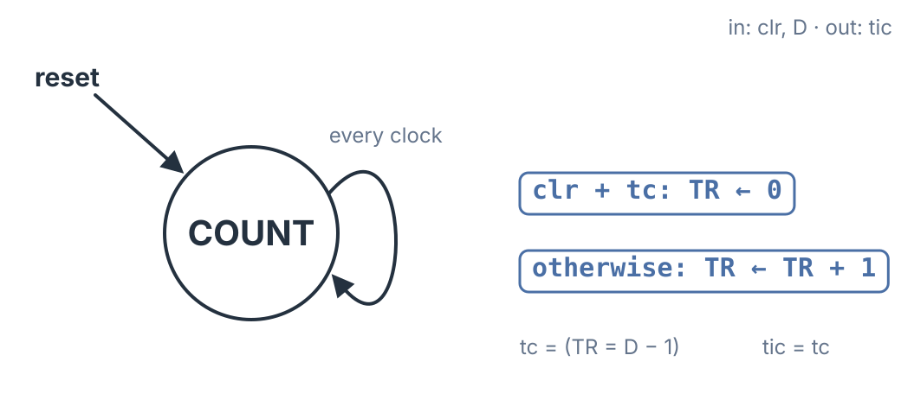

One of the first sequential circuits in this course was a counter, designed as a finite state machine: draw a state for every count, assign codes, and derive the next-state equations. That works, but the design is tied to its length. A counter that rolls over after 6 needs different equations from one that rolls over after 10, and a counter that runs to a million is out of reach. A datapath approach removes that limit. This topic builds a **timer**: a counter whose period is a data input, made from a register, an adder, a mux and a comparator. Widen the register and the same design times any interval. It is also the first worked example of the FSMD method from start to finish, and a small one: the whole controller turns out to be a single OR gate.

## What the Timer Does

The timer has two inputs and one output:

| Signal | Direction | Meaning |
|:--|:--|:--|
| $\mathit{clr}$ | input | while 1, hold the count at 0 |
| $D$ | input, 4 bits | the period, in clocks |
| $\mathit{tic}$ | output | 1 for one clock, once every $D$ clocks |

The count lives in a 4-bit register called $\mathit{TR}$, the **Timer Register**. Four bits keeps the diagrams small; a real timer uses as many bits as its longest period needs.

While $\mathit{clr} = 1$, $\mathit{TR}$ is held at 0. Once $\mathit{clr}$ returns to 0, $\mathit{TR}$ counts $0, 1, \ldots, D - 1$ and starts over at 0. The output $\mathit{tic}$ is 1 during the clock in which $\mathit{TR}$ shows $D - 1$, so it comes once every $D$ clocks. After $\mathit{clr}$ drops, $\mathit{TR}$ is 0 for the first clock and the first $\mathit{tic}$ arrives $D$ clocks later. Two edge cases follow from the same rule: with $D = 1$, $\mathit{TR}$ stays at 0 and $\mathit{tic}$ is 1 on every clock; with $D = 0$, the count runs through all 16 values, because $D - 1$ wraps to 15 in four bits.

## Step 1: The FSMD

The timer counts on every clock unless something restarts it, so its FSMD needs only **one state**, COUNT, which loops back to itself on every clock. All the behavior is in the register transfers, chosen by a condition:

- if $\mathit{clr} + \mathit{tc}$: $\mathit{TR} \leftarrow 0$
- otherwise: $\mathit{TR} \leftarrow \mathit{TR} + 1$

The test condition $\mathit{tc}$ asks whether the count has reached the end of the period:

$$\mathit{tc} = (\mathit{TR} = D - 1)$$

and the output is simply $\mathit{tic} = \mathit{tc}$.



The comparison is against $D - 1$, not $D$, because the restart happens on the *next* clock. When $\mathit{TR}$ shows $D - 1$, the transfer $\mathit{TR} \leftarrow 0$ is set up, and on the following edge $\mathit{TR}$ becomes 0. The register therefore visits exactly $D$ values, $0$ through $D - 1$, and the period is $D$ clocks. Comparing against $D$ would let $\mathit{TR}$ reach $D$ before restarting and stretch the period to $D + 1$.

## Step 2: The Datapath

The datapath comes straight from the register transfers, in four steps.

**A register.** The FSMD stores one value, so the datapath has one register, $\mathit{TR}$. It loads on every clock.

**An adder.** $\mathit{TR} \leftarrow \mathit{TR} + 1$ needs $\mathit{TR} + 1$, so an adder takes $\mathit{TR}$ on one input and the constant 1 on the other.

**A mux.** $\mathit{TR}$ can receive two different values, 0 or $\mathit{TR} + 1$, so a 2-to-1 mux sits in front of it. Its select line is a control signal named $\mathit{zero}$, after what it does: when $\mathit{zero} = 1$ the mux picks input 1, the constant 0, and $\mathit{TR}$ is cleared; when $\mathit{zero} = 0$ it picks input 0, the adder's $\mathit{TR} + 1$, and $\mathit{TR}$ counts.

**A comparator.** The test condition $\mathit{tc}$ needs a comparator that checks $\mathit{TR} = D - 1$. Its output $\mathit{tc}$ is a status signal that goes back to the controller.

## Step 3: The Controller

With one state there is nothing to remember, so the controller needs **no state flip-flops at all**. What is left is the logic that turns the FSMD's condition into the control signal. The FSMD clears $\mathit{TR}$ when $\mathit{clr} + \mathit{tc}$ is true, and clearing $\mathit{TR}$ is $\mathit{zero} = 1$, so:

$$\mathit{zero} = \mathit{clr} + \mathit{tc} \qquad \mathit{tic} = \mathit{tc}$$

The entire controller is one OR gate and a wire. The method did not change. It was the same three steps used for any FSMD, and for this machine they reduce to a single gate. Connected together, $\mathit{clr}$ enters the controller, $\mathit{zero}$ goes from the controller to the mux, and $\mathit{tc}$ comes back from the comparator to drive both the OR gate and the output $\mathit{tic}$.

## Watching It Run

The table is a simulation of the timer with $D = 4$. $\mathit{clr}$ is held at 1 for cycles 0 and 1, released, and pulsed again at cycle 12. Each row is one clock cycle; $\mathit{TR}$ shows the register's contents and $\mathit{tic}$ the comparator's output during that cycle. The last column, $\mathit{tic}_r$, is explained in the next section.

| Cycle | $\mathit{clr}$ | $\mathit{TR}$ | $\mathit{tic}$ | $\mathit{tic}_r$ |
|:-:|:-:|:-:|:-:|:-:|
| 0 | 1 | 0 | 0 | 0 |
| 1 | 1 | 0 | 0 | 0 |
| 2 | 0 | 0 | 0 | 0 |
| 3 | 0 | 1 | 0 | 0 |
| 4 | 0 | 2 | 0 | 0 |
| 5 | 0 | 3 | 1 | 0 |
| 6 | 0 | 0 | 0 | 1 |
| 7 | 0 | 1 | 0 | 0 |
| 8 | 0 | 2 | 0 | 0 |
| 9 | 0 | 3 | 1 | 0 |
| 10 | 0 | 0 | 0 | 1 |
| 11 | 0 | 1 | 0 | 0 |
| 12 | 1 | 2 | 0 | 0 |
| 13 | 0 | 0 | 0 | 0 |
| 14 | 0 | 1 | 0 | 0 |
| 15 | 0 | 2 | 0 | 0 |
| 16 | 0 | 3 | 1 | 0 |
| 17 | 0 | 0 | 0 | 1 |

$\mathit{clr}$ drops at cycle 2, where $\mathit{TR}$ is 0, and the count runs 0, 1, 2, 3. At cycle 5, $\mathit{TR} = 3 = D - 1$, so $\mathit{tc}$ and $\mathit{tic}$ are 1, $\mathit{zero}$ is 1, and $\mathit{TR}$ returns to 0 at cycle 6. The next $\mathit{tic}$ is at cycle 9, four clocks later. At cycle 12, $\mathit{clr}$ interrupts the count at $\mathit{TR} = 2$; the count restarts from 0 at cycle 13 and the next $\mathit{tic}$ comes at cycle 16, again four clocks after the restart.

The same holds if $D$ is changed while the timer is running, with one caveat: the first period after the change can be shorter, because $\mathit{TR}$ is already part way through a count. In the interactive, setting $D = 6$ mid-run gives a first $\mathit{tic}$ after five clocks and then one every six.

## Registering tic

$\mathit{tic}$ comes from a comparator, so it is a combinational signal and can glitch briefly after each clock edge while $\mathit{TR}$ settles. Inside the design that does not matter: every flip-flop that uses $\mathit{tic}$ samples it at the next clock edge, after it has settled, so the count stays exact.

It matters when $\mathit{tic}$ **leaves** the design, to an output pin or to logic on another clock. Then it should come straight off a flip-flop, as described in **Registered Outputs**. One flip-flop does it:

$$\mathit{tic}_r^{+} = \mathit{tc}$$

$\mathit{tic}_r$ is the same pulse with the same period, one clock later and glitch-free, as the table's last column shows: each $\mathit{tic}_r$ pulse follows its $\mathit{tic}$ pulse by exactly one clock. The cost is that clock of latency. A design that counts $N$ clocks and then acts on $\mathit{tic}_r$ would act after $N + 1$, so use $\mathit{tic}$ inside the design and register it only where it leaves.

## The Timer in Verilog

The Verilog follows the datapath and controller block for block: the comparator, the OR gate, the output wire, and the register with its mux and adder. The width is a parameter, so the same module builds a timer of any length.

```verilog
module timer #(parameter W = 4) (
    input  wire         clk,
    input  wire         rst,
    input  wire         clr,
    input  wire [W-1:0] D,
    output wire         tic
);
    reg  [W-1:0] TR;
    wire         tc;
    wire         zero;

    assign tc   = (TR == D - 1'b1);
    assign zero = clr | tc;
    assign tic  = tc;

    always @(posedge clk) begin
        if (rst)
            TR <= {W{1'b0}};
        else if (zero)
            TR <= {W{1'b0}};
        else
            TR <= TR + 1'b1;
    end
endmodule
```

The registered output is one more line wherever the timer is used:

```verilog
always @(posedge clk) tic_r <= rst ? 1'b0 : tic;
```

The module was simulated in Icarus Verilog against a reference written from the description, not the circuit: after $\mathit{clr}$ drops, count clocks $k = 0, 1, 2, \ldots$, and expect $\mathit{TR} = k \bmod D$ with $\mathit{tic} = 1$ when $k \bmod D = D - 1$. For every period $D = 1$ to 15, over 500 clocks each with $\mathit{clr}$ pulsed at random, the bench reports:

```
first tics checked: 203, at D clocks after clr: 203
TOTAL FAILURES: 0
```

## Why the Datapath Approach Pays Off

Compare this with the counter designed as a pure state machine. There, each count was a state, and changing the length meant a new state diagram, a new state assignment and new equations. Here the length is a number on the $D$ input, and making the timer longer means a wider register, adder and comparator, with no change to the controller. The same register, adder, mux and comparator pattern is the counting part of the **Switch Debouncer**, which waits for a button to hold steady for $N$ clocks. A common extension adds an enable input $\mathit{en}$ so the timer counts only when $\mathit{en} = 1$, which lets one timer's $\mathit{tic}$ step another to build very long intervals.

## Key Takeaways

A timer built from a datapath counts clocks with a register $\mathit{TR}$, an adder for $\mathit{TR} + 1$, a 2-to-1 mux that chooses between 0 and $\mathit{TR} + 1$, and a comparator that raises $\mathit{tc}$ when $\mathit{TR} = D - 1$. Its FSMD has a single state with the transfers $\mathit{TR} \leftarrow 0$ if $\mathit{clr} + \mathit{tc}$ and $\mathit{TR} \leftarrow \mathit{TR} + 1$ otherwise. Comparing against $D - 1$ makes the period exactly $D$ clocks, because the restart takes effect on the next edge. With one state, the controller has no flip-flops; it is the single gate $\mathit{zero} = \mathit{clr} + \mathit{tc}$, and the output is $\mathit{tic} = \mathit{tc}$. After $\mathit{clr}$ drops, the first $\mathit{tic}$ comes $D$ clocks later and then every $D$ clocks. When $\mathit{tic}$ leaves the design, one flip-flop gives the glitch-free $\mathit{tic}_r$, the same pulse one clock later. Unlike a counter designed state by state, the timer's length is a data input, and a wider register makes it as long as needed.

## Review Questions

**1. The timer runs with $D = 5$, and $\mathit{clr}$ drops to 0 in cycle 10, where $\mathit{TR}$ is 0. In which cycle is $\mathit{tic}$ first 1?**

A) Cycle 13\
B) Cycle 14\
C) Cycle 15\
D) Cycle 10

**2. Why does the comparator test $\mathit{TR} = D - 1$ rather than $\mathit{TR} = D$?**

A) A 4-bit comparator cannot test for $D$\
B) The restart takes effect on the next clock edge, so testing $D - 1$ gives a period of exactly $D$ clocks; testing $D$ would give $D + 1$\
C) Testing $D$ would make $\mathit{tic}$ last two clocks\
D) $D - 1$ is needed so that $D = 0$ means "never tic"

**3. Why does the timer's controller have no state flip-flops?**

A) The FSMD has only one state, so there is nothing to remember\
B) The register $\mathit{TR}$ is used as the state register\
C) The controller is Mealy, and Mealy machines need no flip-flops\
D) The mux remembers the state

**4. Which equation is the control signal for the mux?**

A) $\mathit{zero} = \mathit{clr} \cdot \mathit{tc}$\
B) $\mathit{zero} = \overline{\mathit{clr}} + \mathit{tc}$\
C) $\mathit{zero} = \mathit{clr} + \mathit{tc}$\
D) $\mathit{zero} = \mathit{tc}$

**5. $\mathit{tic}$ drives an output pin of the chip. What should be done, and what does it cost?**

A) Nothing; $\mathit{tic}$ is already a flip-flop output\
B) Register it with one flip-flop, $\mathit{tic}_r^{+} = \mathit{tc}$; the pulse is glitch-free with the same period, one clock later\
C) Pass it through a second comparator to remove glitches; no cost\
D) Register it with one flip-flop; the period becomes $D + 1$

## Answer Explanations

**1. B.** $\mathit{TR}$ counts 0, 1, 2, 3, 4 in cycles 10 through 14, and $\mathit{tic} = 1$ when $\mathit{TR} = D - 1 = 4$, which is cycle 14. That is $D = 5$ clocks of counting after $\mathit{clr}$ drops. Cycle 13 (A) is one clock early, cycle 15 (C) is when $\mathit{TR}$ is back at 0, and cycle 10 (D) is where $\mathit{TR}$ starts.

**2. B.** When $\mathit{TR} = D - 1$, the transfer $\mathit{TR} \leftarrow 0$ is set up and happens at the next edge, so $\mathit{TR}$ visits exactly the $D$ values $0$ through $D - 1$. With $\mathit{TR} = D$, the register would reach $D$ before restarting and visit $D + 1$ values. The comparator width (A) is not the issue, $\mathit{tic}$ is still one clock either way (C), and $D = 0$ actually gives a period of 16 (D).

**3. A.** A state register exists to record which state the machine is in. With one state, the answer is always COUNT, so no flip-flops are needed, and the controller is pure logic. $\mathit{TR}$ is a datapath register, not the state (B); a Mealy machine with more than one state still needs state flip-flops (C); and a mux stores nothing (D).

**4. C.** The FSMD clears $\mathit{TR}$ when $\mathit{clr}$ is 1 *or* the count reaches $D - 1$, and clearing is $\mathit{zero} = 1$, so $\mathit{zero} = \mathit{clr} + \mathit{tc}$. An AND (A) would clear only when both are true, (B) would clear whenever $\mathit{clr}$ is 0, and (D) would ignore $\mathit{clr}$.

**5. B.** $\mathit{tic}$ comes from a comparator, so it is combinational and can glitch; a signal leaving the design should come straight off a flip-flop. $\mathit{tic}_r^{+} = \mathit{tc}$ gives the same pulse, same period, one clock late. $\mathit{tic}$ is not a flip-flop output (A), another comparator is still combinational (C), and the period does not change (D); only the latency does.
