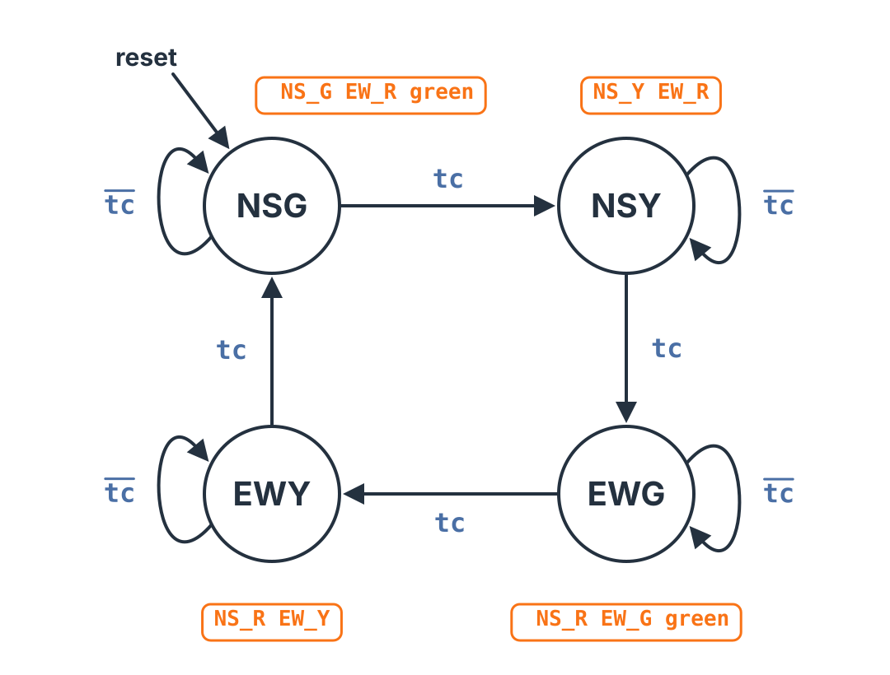

The traffic-light controller is a classic problem in a first digital logic course, and for a good reason: the logic is simple, but it needs the whole design stack. The lights step through their phases like any finite state machine, but each phase has to last a set number of clock cycles, and a state diagram has no clock in it. The answer is a finite state machine with a datapath (FSMD): a register counts the clocks in each phase, and the controller moves on when the count runs out. This topic works the problem from the specification through the FSMD, the datapath, the controller and a simulated timing trace.

## The Intersection and Its Four Phases

Two roads cross, **North–South** and **East–West**, and each has a red, yellow and green light, so the controller has six outputs: $\mathit{NS\_R}$, $\mathit{NS\_Y}$, $\mathit{NS\_G}$ and $\mathit{EW\_R}$, $\mathit{EW\_Y}$, $\mathit{EW\_G}$. Its only inputs are the clock and reset.

Although there are six lights, there are only four situations the controller has to produce, always in the same order:

| Phase | State | North–South | East–West | Lasts |
|:-:|:--|:-:|:-:|:-:|
| 1 | NSG | green | red | $D_G = 4$ clocks |
| 2 | NSY | yellow | red | $D_Y = 2$ clocks |
| 3 | EWG | red | green | $D_G = 4$ clocks |
| 4 | EWY | red | yellow | $D_Y = 2$ clocks |

Reset starts the controller in NSG. The one safety rule is that **both roads must never have green at the same time**. Each green light is on in exactly one state, NS green only in NSG and EW green only in EWG, so the rule holds by construction.

The durations here are small, four clocks for green and two for yellow, so the timing trace fits on one screen. A real controller would count seconds' worth of clocks. The problem is set up symmetrically; an intersection with one busy road would give that road a longer green.

## Timing Each Phase: The FSMD

One register, $\mathit{TR}$, counts the clocks spent in the current phase. Every state does the same two things:

- While $\mathit{TR} \ne D - 1$, stay in the state and count: $\mathit{TR} \leftarrow \mathit{TR} + 1$.
- When $\mathit{TR} = D - 1$, move to the next phase and clear the count: $\mathit{TR} \leftarrow 0$.

Here $D$ is the phase's length: $D_G = 4$ in the green states and $D_Y = 2$ in the yellow ones. NSG and NSY differ only in the limit they test. As in the **Timer Circuit**, the test is against $D - 1$ because the move takes effect on the next clock edge, so $\mathit{TR}$ visits exactly $D$ values, $0$ through $D - 1$, and the phase lasts exactly $D$ clocks.

The register transfers in this FSMD sit **on the arcs**, not in the states: what happens to $\mathit{TR}$ depends on the state *and* on the test. That is a Mealy-style FSMD. The **Switch Debouncer**, by contrast, attaches each transfer to a state. The interactive above draws the full FSMD, with every self-loop labeled $\mathit{TR} \ne D - 1$, $\mathit{TR} \leftarrow \mathit{TR} + 1$ and every leaving arc labeled $\mathit{TR} = D - 1$, $\mathit{TR} \leftarrow 0$.

## Reading the Datapath off the FSMD

Every operation in the FSMD becomes a piece of hardware.

**One register, $\mathit{TR}$.** Every transfer writes $\mathit{TR}$, and some transfer happens in every state on every clock, so $\mathit{TR}$ loads every cycle and needs no load enable.

**An adder for $\mathit{TR} + 1$**, with $\mathit{TR}$ on one input and the constant 1 on the other.

**A mux in front of $\mathit{TR}$**, because $\mathit{TR}$ loads one of two values: $\mathit{TR} + 1$ while counting, or 0 when the phase ends. The select is the test result itself, $\mathit{tc}$: when $\mathit{tc} = 1$ the mux picks input 1, the constant 0, and $\mathit{TR}$ clears.

**A comparator** for the test $\mathit{TR} = D - 1$, whose output is the status signal $\mathit{tc}$. Since $D$ takes two values, a second mux picks it: $D_G$ on input 1 and $D_Y$ on input 0, with select $\mathit{green}$. In a green state $D = 4$, so $\mathit{tc}$ goes high when $\mathit{TR} = 3$; in a yellow state $D = 2$, and $\mathit{tc}$ goes high when $\mathit{TR} = 1$.

That is the whole datapath: one register, one adder, two muxes and one comparator, the same pattern as the **Timer Circuit**. One signal, $\mathit{green}$, comes in from the controller, and one, $\mathit{tc}$, goes back to it.

## The Controller

With the datapath handling $\mathit{TR}$, the controller only has to step the phases. Take the FSMD and keep just the signals: each condition becomes the status input $\mathit{tc}$, and the transfers disappear because the datapath now does them. What is left is an ordinary finite state machine with one scalar input, $\mathit{tc}$, and seven outputs: $\mathit{green}$ and the six lights. Each state moves to the next on $\mathit{tc}$ and stays on $\overline{\mathit{tc}}$:



From here it is a regular state-machine design problem. With a one-hot assignment, one flip-flop per state, each next-state equation has one term per arc into the state:

$$Q_{\mathrm{NSG}}^{+} = Q_{\mathrm{NSG}} \cdot \overline{\mathit{tc}} + Q_{\mathrm{EWY}} \cdot \mathit{tc} \qquad Q_{\mathrm{NSY}}^{+} = Q_{\mathrm{NSY}} \cdot \overline{\mathit{tc}} + Q_{\mathrm{NSG}} \cdot \mathit{tc}$$

$$Q_{\mathrm{EWG}}^{+} = Q_{\mathrm{EWG}} \cdot \overline{\mathit{tc}} + Q_{\mathrm{NSY}} \cdot \mathit{tc} \qquad Q_{\mathrm{EWY}}^{+} = Q_{\mathrm{EWY}} \cdot \overline{\mathit{tc}} + Q_{\mathrm{EWG}} \cdot \mathit{tc}$$

The outputs are all Moore, read off the states:

$$\mathit{green} = Q_{\mathrm{NSG}} + Q_{\mathrm{EWG}}$$

$$\mathit{NS\_G} = Q_{\mathrm{NSG}} \qquad \mathit{NS\_Y} = Q_{\mathrm{NSY}} \qquad \mathit{NS\_R} = Q_{\mathrm{EWG}} + Q_{\mathrm{EWY}}$$

$$\mathit{EW\_G} = Q_{\mathrm{EWG}} \qquad \mathit{EW\_Y} = Q_{\mathrm{EWY}} \qquad \mathit{EW\_R} = Q_{\mathrm{NSG}} + Q_{\mathrm{NSY}}$$

Because exactly one state flip-flop is 1 at a time, $\mathit{NS\_G} \cdot \mathit{EW\_G} = Q_{\mathrm{NSG}} \cdot Q_{\mathrm{EWG}} = 0$: the safety rule again, now in the equations.

**Is this Mealy or Moore?** Both, in different places. Clearing $\mathit{TR}$ depends on the state and on $\mathit{tc}$, so it is a Mealy control signal: $\mathit{clr} = (Q_{\mathrm{NSG}} + Q_{\mathrm{NSY}} + Q_{\mathrm{EWG}} + Q_{\mathrm{EWY}}) \cdot \mathit{tc}$. Exactly one state is active, so the sum is always 1 and $\mathit{clr} = \mathit{tc}$, which is why the datapath simply wires $\mathit{tc}$ to the mux select. A Mealy signal inside a datapath is harmless, because the register only samples it at a clock edge. The lights leave the circuit, so they are Moore outputs, taken straight from the state.

## Watching It Run

The table is a simulation of the complete controller and datapath with $D_G = 4$ and $D_Y = 2$, from reset. Each row is one clock cycle; $\mathit{tc}$ is the comparator's output during that cycle.

| Cycle | State | $\mathit{green}$ | $D$ | $\mathit{TR}$ | $\mathit{tc}$ | NS | EW |
|:-:|:-:|:-:|:-:|:-:|:-:|:-:|:-:|
| 0 | NSG | 1 | 4 | 0 | 0 | G | R |
| 1 | NSG | 1 | 4 | 1 | 0 | G | R |
| 2 | NSG | 1 | 4 | 2 | 0 | G | R |
| 3 | NSG | 1 | 4 | 3 | 1 | G | R |
| 4 | NSY | 0 | 2 | 0 | 0 | Y | R |
| 5 | NSY | 0 | 2 | 1 | 1 | Y | R |
| 6 | EWG | 1 | 4 | 0 | 0 | R | G |
| 7 | EWG | 1 | 4 | 1 | 0 | R | G |
| 8 | EWG | 1 | 4 | 2 | 0 | R | G |
| 9 | EWG | 1 | 4 | 3 | 1 | R | G |
| 10 | EWY | 0 | 2 | 0 | 0 | R | Y |
| 11 | EWY | 0 | 2 | 1 | 1 | R | Y |
| 12 | NSG | 1 | 4 | 0 | 0 | G | R |

In NSG, $\mathit{green} = 1$ selects $D = 4$, and $\mathit{TR}$ counts 0, 1, 2, 3. At cycle 3, $\mathit{TR} = 3 = D - 1$, so $\mathit{tc} = 1$: on the next edge the controller moves to NSY and the datapath clears $\mathit{TR}$ to 0. In NSY, $\mathit{green} = 0$ selects $D = 2$, so $\mathit{tc}$ goes high when $\mathit{TR} = 1$, two clocks later. The pattern repeats for East–West, and at cycle 12 the controller is back in NSG: one full round is $4 + 2 + 4 + 2 = 12$ clocks, and the two greens never overlap. The interactive's **Timing Trace** tab steps through the same run one clock at a time, lighting the active state, arc and datapath values.

## The Controller in Verilog

The Verilog follows the hardware block for block: the datapath (the $D$ mux, the comparator, and register $\mathit{TR}$ with its adder and mux), the one-hot controller with one term per arc, and the Moore outputs. It is here for reference, to come back to when the course turns to describing state machines in Verilog.

```verilog
module traffic #(
  parameter DG = 4,  // green: clocks
  parameter DY = 2   // yellow: clocks
) (
  input  clk, rst,
  output NS_R, NS_Y, NS_G,
  output EW_R, EW_Y, EW_G
);
  reg  q_nsg, q_nsy, q_ewg, q_ewy;  // one-hot
  reg  [3:0] tr;     // register TR
  wire [3:0] d;      // the limit is D - 1
  wire tc;           // status
  wire green;        // control

  // datapath: a mux picks D, a comparator
  // tests TR = D - 1; register TR with
  // its adder and mux
  assign d  = green ? DG : DY;
  assign tc = (tr == d - 1'b1);
  always @(posedge clk)
    if (rst)     tr <= 0;
    else if (tc) tr <= 0;          // mux: 0
    else         tr <= tr + 1'b1;  // adder
  // controller: one term per arc
  always @(posedge clk)
    if (rst) begin
      q_nsg <= 1'b1;
      q_nsy <= 1'b0;
      q_ewg <= 1'b0;
      q_ewy <= 1'b0;
    end
    else begin
      q_nsg <= q_nsg & ~tc
             | q_ewy & tc;
      q_nsy <= q_nsy & ~tc
             | q_nsg & tc;
      q_ewg <= q_ewg & ~tc
             | q_nsy & tc;
      q_ewy <= q_ewy & ~tc
             | q_ewg & tc;
    end

  // outputs: all Moore
  assign green = q_nsg | q_ewg;
  assign NS_G  = q_nsg;
  assign NS_Y  = q_nsy;
  assign NS_R  = q_ewg | q_ewy;
  assign EW_G  = q_ewg;
  assign EW_Y  = q_ewy;
  assign EW_R  = q_nsg | q_nsy;
endmodule
```

Simulated in Icarus Verilog for 26 clocks against an independently written model that counts phases directly, the module reports:

```
mismatches=0 bothgreen=0 onehot_bad=0 phase_len_bad=0 phase_start_tr_bad=0 phases_checked=8
```

The two versions agree on every cycle, the greens never overlap, exactly one state flip-flop is 1 at all times, every phase lasts its $D$ clocks, and every phase starts with $\mathit{TR} = 0$.

## Key Takeaways

A traffic-light controller is an FSMD: the controller steps through four phases (NSG, NSY, EWG, EWY), and a datapath times each one. In the FSMD every state counts with $\mathit{TR} \leftarrow \mathit{TR} + 1$ while $\mathit{TR} \ne D - 1$ and moves on with $\mathit{TR} \leftarrow 0$ when $\mathit{TR} = D - 1$, where $D$ is $D_G$ for green and $D_Y$ for yellow; testing $D - 1$ makes each phase last exactly $D$ clocks. The datapath reads straight off the FSMD: a register $\mathit{TR}$ that loads every clock, an adder for $\mathit{TR} + 1$, a mux on $\mathit{tc}$ choosing 0 or $\mathit{TR} + 1$, a comparator for $\mathit{TR} = D - 1$ producing $\mathit{tc}$, and a mux on $\mathit{green}$ choosing $D$. Stripping the FSMD down to its signals leaves an ordinary FSM with input $\mathit{tc}$, which a one-hot assignment turns into one term per arc. The lights and $\mathit{green}$ are Moore outputs, and because only one state is ever active, the two greens can never be on together. The register's clear is a Mealy control signal that reduces to the wire $\mathit{tc}$.

## Review Questions

**1. Why does the traffic-light controller need a datapath at all, instead of a plain state machine with four states?**

A) A plain state machine cannot have six outputs\
B) Each phase must last a set number of clocks, and a register that counts is a simple way to time it without a state per clock\
C) The safety rule cannot be met without a comparator\
D) A plain state machine cannot be reset

**2. In the FSMD, a green state stays put while $\mathit{TR} \ne D_G - 1$ and leaves when $\mathit{TR} = D_G - 1$. With $D_G = 4$, how many clocks does a green phase last?**

A) 3\
B) 5\
C) 4\
D) 8

**3. Why does register $\mathit{TR}$ need no load enable?**

A) Some transfer writes $\mathit{TR}$ in every state on every clock, either $\mathit{TR} \leftarrow \mathit{TR} + 1$ or $\mathit{TR} \leftarrow 0$\
B) $\mathit{TR}$ is only read, never written\
C) The comparator holds $\mathit{TR}$'s value between phases\
D) A load enable would break the safety rule

**4. In the datapath, the mux that chooses $D$ has $D_G$ on input 1 and $D_Y$ on input 0. What drives its select?**

A) $\mathit{tc}$, from the comparator\
B) The clock\
C) $\mathit{TR}$, from the register\
D) $\mathit{green} = Q_{\mathrm{NSG}} + Q_{\mathrm{EWG}}$, from the controller

**5. Why can $\mathit{NS\_G}$ and $\mathit{EW\_G}$ never both be 1?**

A) The comparator never outputs two 1s in a row\
B) $\mathit{NS\_G} = Q_{\mathrm{NSG}}$ and $\mathit{EW\_G} = Q_{\mathrm{EWG}}$, and with one-hot exactly one state flip-flop is 1 at a time\
C) $\mathit{tc}$ is always 0 in the green states\
D) The yellow phases are shorter than the green ones

## Answer Explanations

**1. B.** Without a datapath, every clock of every phase would need its own state: twelve states for this short example, and thousands for real durations. A register that counts lets four states do the job, each waiting for $\mathit{tc}$. Six outputs are no problem for a state machine (A), the safety rule comes from the state assignment, not a comparator (C), and a state machine resets the usual way (D).

**2. C.** $\mathit{TR}$ starts at 0 when the phase begins and counts 0, 1, 2, 3. At $\mathit{TR} = 3 = D_G - 1$ the controller leaves on the next edge, so the phase spans four clocks, exactly $D_G$. Three (A) forgets the clock where $\mathit{TR} = 0$, five (B) would come from testing $\mathit{TR} = D_G$, and eight (D) is two green phases.

**3. A.** A load enable lets a register hold its value, which is only needed when some state leaves it alone. Here every arc of the FSMD writes $\mathit{TR}$, counting on the self-loops and clearing on the leaving arcs, so it loads every clock and the mux alone chooses what. $\mathit{TR}$ is written constantly (B), the comparator stores nothing (C), and the enable has nothing to do with the lights (D).

**4. D.** $D$ must be $D_G$ in the green states and $D_Y$ in the yellow ones, so the select is a controller output that is 1 exactly in NSG and EWG: $\mathit{green} = Q_{\mathrm{NSG}} + Q_{\mathrm{EWG}}$. $\mathit{tc}$ (A) selects the other mux, the one in front of $\mathit{TR}$; the clock (B) and $\mathit{TR}$ (C) do not say which phase the controller is in.

**5. B.** Each green output comes from exactly one state flip-flop, and a one-hot state register has exactly one flip-flop set, so $Q_{\mathrm{NSG}} \cdot Q_{\mathrm{EWG}} = 0$ always. The comparator (A), $\mathit{tc}$ (C) and the phase lengths (D) all affect timing, not which lights can be on together.
